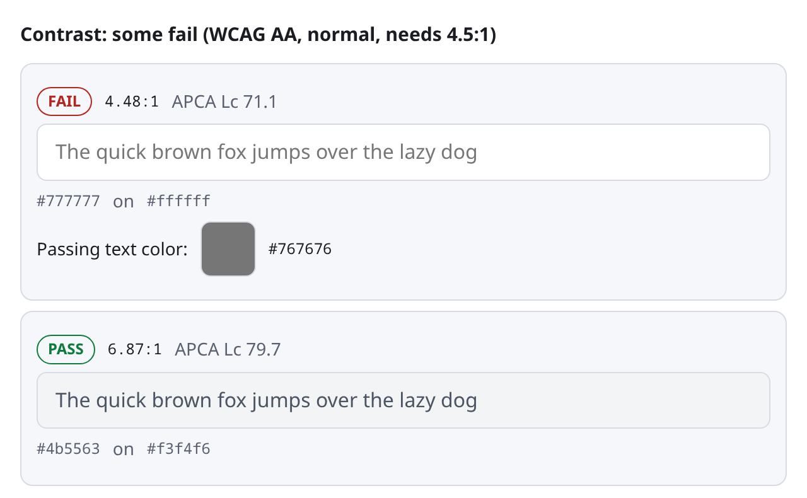
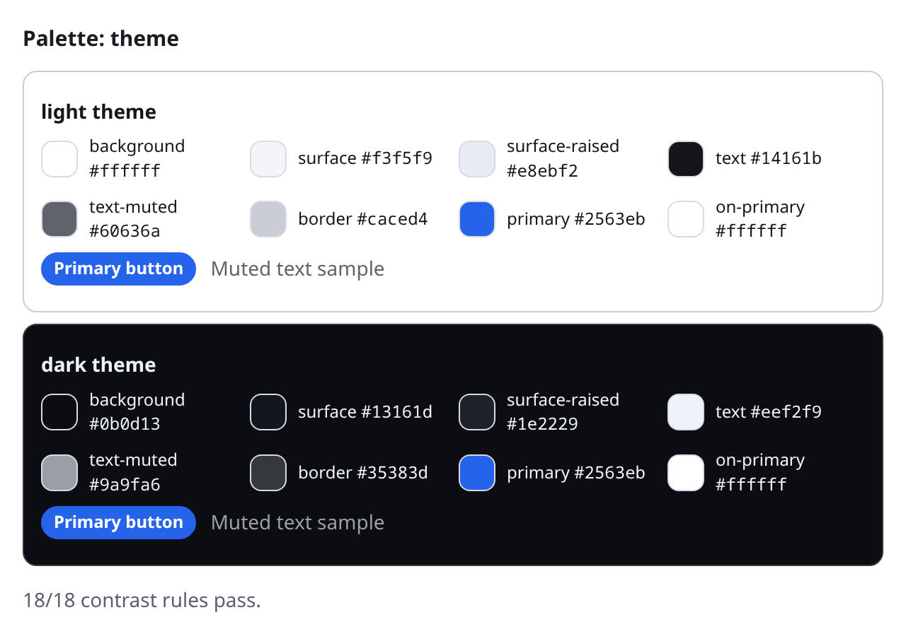
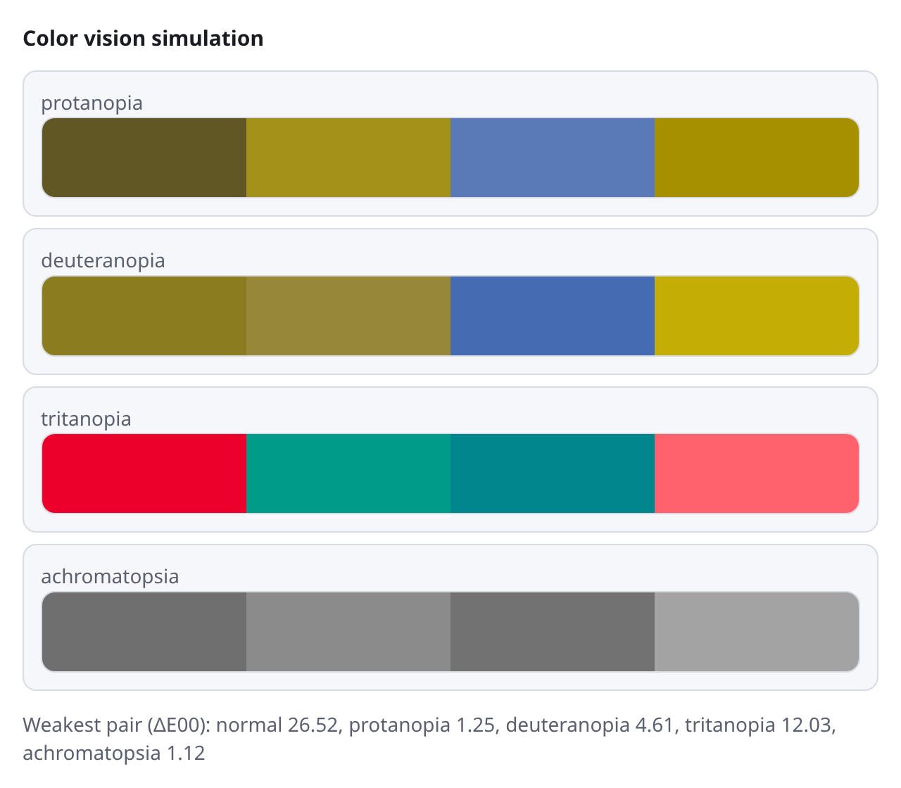

# Colors MCP Server

Exact color math, accessibility checks and ready-made palettes for AI agents.

[](https://www.npmjs.com/package/@htetoowaiyan/colors-mcp-server)
[](LICENSE)
[](package.json)

> **Built entirely by AI agents.** Every line of code, test, benchmark and document here was written by AI agents. The maintainer is not a domain expert in color theory and has not checked the color math by hand. Correctness rests on published formulas, cross-checks against [Color.js](https://colorjs.io), and the benchmark results below, not on expert review. Report any error you find.

**On this page:** [Why](#why) · [Example](#example) · [Install](#install) · [Tools](#tools) · [Agent guidance](#agent-guidance) · [Benchmarks](#benchmarks) · [Reference](#reference)

---

## Why

Small and mid-size models cannot compute contrast ratios, OKLCH conversions, gamut mapping or color-blind simulation in their heads. They guess, or they run out of output tokens trying. This server does the math in one tool call and returns a verified answer.

- **Covers:** UI and web design, design systems, data visualization, print, video, photo and games.
- **Pure computation:** no network, no files, no side effects.
- **Built for small models:** one list-shaped input per tool, flat forgiving schemas, errors that say how to fix the call.

## Example

An agent asks for an outcome and gets a finished result. Every result starts with the verdict.

```text
colors_check   {"foreground":"#777777","background":"#ffffff"}
→ FAIL: 4.48:1, needs 4.5:1 for WCAG AA normal text.
  Passing alternative text color: #767676

colors_fix     {"foreground":"#777777","background":"#ffffff"}
→ Use #767676 (was #777777). Contrast on #ffffff is 4.54:1, up from 4.48:1; target 4.5:1 met.

colors_palette {"kind":"categorical","count":4}
→ 4 categorical colors for #ffffff background, each at least 3:1 against it:
  #e556f3, #003905, #36aa3d, #460062
  Weakest pair difference (CIEDE2000; higher is better): normal 38.2, protanopia 36.5, deuteranopia 36.6, tritanopia 36.1.
```

Hosts that support MCP Apps also show the result visually:

| Contrast check | Light and dark theme |
| --- | --- |
|  |  |



## Install

Needs Node 20 or newer. Run it directly:

```bash
npx -y @htetoowaiyan/colors-mcp-server
```

Or add it to your client:

**Claude Code**

```bash
claude mcp add colors -- npx -y @htetoowaiyan/colors-mcp-server
```

**Claude Desktop, Cursor and most other clients** (`mcpServers` in the client's config file)

```json
{
  "mcpServers": {
    "colors": { "command": "npx", "args": ["-y", "@htetoowaiyan/colors-mcp-server"] }
  }
}
```

**VS Code** (`.vscode/mcp.json`)

```json
{
  "servers": {
    "colors": { "command": "npx", "args": ["-y", "@htetoowaiyan/colors-mcp-server"] }
  }
}
```

**Codex** (`~/.codex/config.toml`)

```toml
[mcp_servers.colors]
command = "npx"
args = ["-y", "@htetoowaiyan/colors-mcp-server"]
```

## Tools

Thirteen tools. Every tool also returns `structuredContent` with a declared `outputSchema`.

### Finished answers

Ask for an outcome, get a result.

| Tool | Use it to |
| --- | --- |
| `colors_check` | Pass or fail WCAG 2 contrast for one or many pairs (AA or AAA; normal text, large text or UI parts). Also reports the signed APCA Lc (positive dark-on-light, negative light-on-dark) and a nearby passing color for each failure. Handles translucent colors. |
| `colors_fix` | Get the closest color with the same hue that reaches a target ratio on a given background. |
| `colors_palette` | Build a finished palette: `ramp` (11-step tonal scale containing the seed), `theme` (light and dark tokens, every contrast rule checked), `categorical` (N distinct, color-blind-safe chart colors) or `diverging` (two colors through a light neutral, symmetric lightness). |
| `colors_find` | Find colors that meet your rules in one call: hue band, chroma and lightness ranges, contrast against one or more surfaces, and for several colors a minimum lightness gap, hue gap or color difference (optionally color-blind safe). Says which rule cannot be met when none can. |
| `colors_scrim` | Find the smallest overlay opacity at which text reaches a contrast ratio on every worst-case region of an image. |
| `colors_audit` | Scan CSS for text contrast, non-text contrast and near-duplicate tokens. Resolves `var(--x)`. |

### Exact helpers

Precise building blocks for work the finished tools do not cover.

| Tool | Use it to |
| --- | --- |
| `colors_info` | Validate colors and describe them: formats, closest name, lightness, contrast on white and black. A bad input gets a suggestion. |
| `colors_convert` | Convert between color spaces (see the list below). A color outside sRGB loses chroma only, and the result says so. |
| `colors_compare` | Rank candidates by CIEDE2000 (default), CIE94, CIE76 or Oklab distance, or report all four at once (D65 Lab), with a plain-words verdict. |
| `colors_blend` | Build gradients and mixes in OKLCH (shorter hue arc, safe for grays), OKLab, sRGB or linear-light sRGB. |
| `colors_adjust` | Change lightness, chroma or hue by an exact OKLCH amount (add, multiply or set). |
| `colors_harmony` | Build complementary, split-complementary, triadic, tetradic and analogous schemes by OKLCH hue rotation. |
| `colors_vision` | Simulate protanopia, deuteranopia, tritanopia and achromatopsia (Machado 2009), and measure whether a set of colors stays distinguishable. |

### Formats read and written by `colors_convert`

All of these are accepted as input too.

| Family | Formats |
| --- | --- |
| sRGB | hex, rgb, hsl, hwb, hsv (also `hsb`), linear sRGB |
| Perceptual | oklch, oklab |
| CIELAB | CSS `lab` / `lch` (D50), `lab-d65` / `lch-d65` (D65 white, no adaptation) |
| CIE XYZ | xyz (D65) |
| Wide gamut | display-p3, `rec2020` (CSS, 2.4 gamma), `rec2020-oetf` (BT.2020 transfer function), `rec2020-linear` |

CMYK output is missing on purpose: an accurate RGB-to-CMYK conversion needs the press's ICC profile, and a formula would mislead. The print guide says what to do instead.

## Agent guidance

Besides the tools, the server gives the model some help to use them well.

| What | Where | Purpose |
| --- | --- | --- |
| Server instructions | sent on connect | A short routing guide so a model calls the tools instead of guessing. |
| Guides | `colors://guide/{topic}` (index: `colors://guide`) | Field guides for `accessibility`, `ui-design`, `dataviz`, `print`, `film-video`, `photo`, `games`, `social-brand`. |
| Prompts | `review-colors`, `brand-color-system`, `fix-accessibility` | Ready-made starting points. |
| Agent Skill | `skill://color-expert/SKILL.md` (`io.modelcontextprotocol/skills` extension) | The guides as references. |
| MCP App | `ui://colors/viewer.html` | Visual result viewer. One self-contained file, no network access. |

## Benchmarks

The `evals/` package measures whether the server helps. A grader built from hand-written color math marks each answer pass or fail. Each task runs twice per model, with and without the server, and tool results reach the model as text only. Models: Haiku 5.5 and GPT-6 Luna.

### Versus other color MCP servers

The test is the **neutral suite**, version 3: 60 tasks in 12 color domains (APCA contrast, ΔE, space conversion, color properties, color-blind simulation, interpolation, harmony, naming, tonal scales, role tokens, constraint search, palette audit).

How it was kept fair:
- Authors wrote the tasks blind, with no sight of any server's tools. Prompts name the standard to use (APCA-W3, CIEDE2000 D65, Machado 2009, CSS Color 4, WCAG 2, BT.2020).
- Graders accept any correct implementation.
- An independent solver re-solved all 60 using only Color.js.
- The suite was frozen before any server ran, and it was written after the last change to this server. Nothing was tuned on it.

**Result** (mean pass rate over both models; 240 runs per row):

| Server | Pass rate | This server minus it [95% interval] |
| --- | --- | --- |
| **This server (2.1.0)** | **62%** | |
| color-theory-mcp | 46% | +0.17 [0.07, 0.27] |
| color-engine-mcp | 36% | +0.26 [0.15, 0.38] |
| mcp-color-convert | 23% | +0.39 [0.29, 0.50] |
| coolors-mcp | 19% | +0.43 [0.32, 0.54] |
| *No tools* | *16%* | |

How to read it:
- The lead over every server is clear: every interval excludes zero.
- Only this server and color-theory-mcp help by a wide margin. coolors-mcp and mcp-color-convert cannot be told apart from no tools.
- Gain over no tools for this server: +0.55 for Haiku, +0.38 for GPT-6 Luna.
- The interval comes from resampling tasks (paired, per task).
- Version 3 is harder than version 2 (no tools drops from 25% to 16%), so compare ranks and paired differences, not the absolute rate.

**By capability** (pass rate, both models):

| Server | Measurement and lookup | Simulation, interpolation, harmony | Design-system generation | Constraint search and audit |
| --- | --- | --- | --- | --- |
| **This server** | **60%** | **72%** | **45%** | **73%** |
| color-theory-mcp | 33% | 70% | 30% | 58% |
| color-engine-mcp | 37% | 42% | 15% | 48% |
| mcp-color-convert | 19% | 43% | 3% | 25% |
| coolors-mcp | 15% | 30% | 8% | 25% |
| *No tools* | *13%* | *15%* | *15%* | *25%* |

**Where this server is weakest:** APCA contrast (40%), delta-E (40%) and role tokens (30%). A large part is the small models hitting their step or token limit before answering, and GPT-6 Luna doing delta-E arithmetic by hand instead of calling `colors_compare`. color-engine-mcp beats this server on APCA (70%).

Server instructions made no measurable difference (65% with them, −0.03 [−0.08, 0.03]).

Servers tested: coolors-mcp 1.1.0, mcp-color-convert 0.1.3, color-theory-mcp (commit 95085b9), color-engine-mcp 1.0.1.

**History.** The first neutral suite showed a much smaller lead over color-theory-mcp (+0.05, not established) and exposed real gaps: APCA was computed but not shown, and standard color spaces and ΔE variants were missing. Those were fixed, and the later suites were written afterwards. Reports for every suite: [`evals/results/reports/`](evals/results/reports). The v3 report is [`neutral-v3-final-2026-11-12.md`](evals/results/reports/neutral-v3-final-2026-11-12.md).

### This server against its own earlier versions

<details>
<summary>Sealed suite (32 tasks, never seen by the tool designer)</summary>

Written from designer briefs by an author who never saw the tools or any results: picking colors under several rules, the smallest scrim over a photo, one color for light and dark surfaces, alpha compositing and `color-mix()` arithmetic, grayscale-safe chart colors, diverging scales, gradient-text legibility and video Y'CbCr conversion. Each task ran once per server version; the report shows totals only.

| Model | No tools | 2.0 server | Current server |
| --- | --- | --- | --- |
| Haiku 5.5 | 53% | 86% | 95% |
| GPT-6 Luna | 52% | 61% | 77% |

The current server beats no tools by +0.34 [0.17, 0.50], and beats 2.0 (which had no `colors_find`, `colors_scrim` or diverging palette) by +0.12 [0.02, 0.22].

</details>

<details>
<summary>Main suite (56 tasks, 14 categories)</summary>

Contrast fixes, gradients, tonal ramps, light and dark themes, CSS audits, color-blind-safe chart colors and more. The tasks and the first tools cover the same categories, so this suite shows that the tools cover it, not that they generalize. Pass rate on its 42 development tasks:

| Model | No tools | 1.x server | Current server |
| --- | --- | --- | --- |
| Haiku 5.5 | 38% | 79% | 96% |
| GPT-6 Luna | 48% | 61% | 99% |

The 14 held-out tasks were last run against the 2.0 server: both models passed all 14, against 32% and 46% without tools. The current server did not re-run them.

</details>

### Limits of these numbers

- GPT-6 Luna gains less than Haiku. The remaining misses are mostly arithmetic the tools do not cover, such as compositing and Y'CbCr.
- The tool list is about 18,000 characters, so each run uses roughly 17% to 21% more input tokens.
- Only two small models, two trials and five tasks per category, so per-category figures are descriptive only.
- The 12 neutral domains were chosen from what the compared servers advertise; eight of the twelve favour servers built from small primitive tools.
- The authors' session context included recent commit messages naming the new capabilities. They were told to ignore them, but a small leak cannot be ruled out.
- Print, photo and game work have guides but no benchmark tasks.
- Suites that informed a fix are no longer fair tests of that fix. Only the sealed suite and neutral v3 are.

Method and commands: [`evals/README.md`](evals/README.md).

## Reference

### Protocol support

The server uses the stable v2 SDK (`@modelcontextprotocol/server`) and `serveStdio`, so one process speaks both protocol eras:

- **2026-07-28:** stateless, with `server/discover`, `resultType`, cache hints on list results and resources, and a fixed tool order.
- **2025-11-25 and earlier:** the `initialize` handshake, for clients that have not upgraded.

### Migrating from 1.x

2.0.0 replaced the tool surface.

| 1.x | 2.x |
| --- | --- |
| `colors_contrast`, `colors_batch_contrast` | `colors_check` (`pairs` for many) |
| `colors_convert`, `colors_batch_convert` | `colors_convert` (`colors` is a list; output uses CSS space-separated syntax) |
| `colors_parse` | `colors_info` |
| `colors_adjust`, `colors_batch_adjust` | `colors_adjust` (`property`, `mode` and `amount`) |
| `colors_mix`, `colors_scale` | `colors_blend` |
| `colors_difference`, `colors_batch_difference` | `colors_compare` (CIEDE2000; 1.x used Euclidean Oklab) |

New in 2.x: `colors_fix`, `colors_palette`, `colors_find`, `colors_scrim`, `colors_audit`, `colors_harmony` and `colors_vision`. The color engine moved from culori to Color.js, plus hand-written math for CIEDE2000, gamut mapping and color-blind simulation, checked against published test vectors.

### Development

```bash
npm install
npm test            # unit and integration tests (both protocol eras in memory) plus a real stdio process
npm run lint
npm run build:ui    # rebuild the viewer into src/ui/viewer.generated.ts (committed)
npm run build
npm run inspect     # open the MCP Inspector
```

To run the evals (they call models through a local inference proxy; setup is in [`evals/README.md`](evals/README.md)):

```bash
cd evals && npm ci
npm test
npm run cli -- preflight --server-ref working-tree --cases v2
npm run cli -- run --run-id v2 --server-ref working-tree
```

### License

MIT
